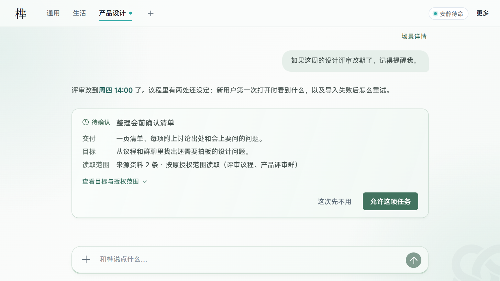
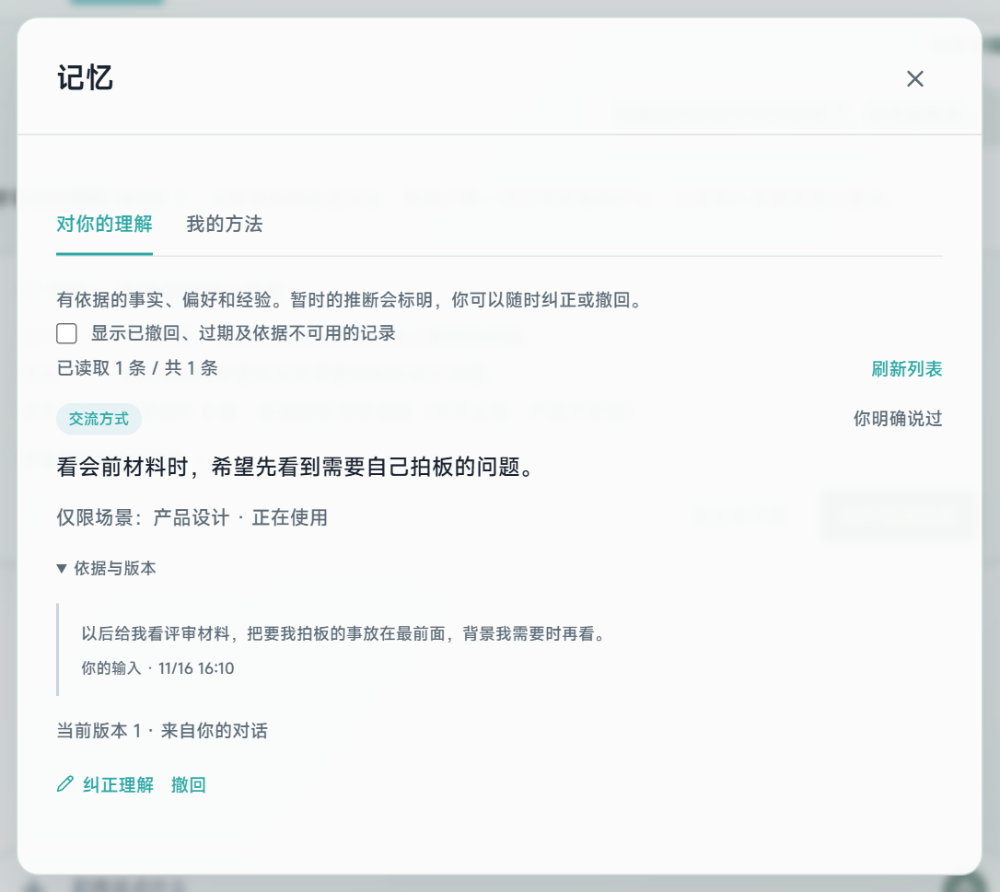

<p align="center">
  
</p>

<h1 align="center">榫 Tenon</h1>

<p align="center">一个可以自己部署、在长期相处中了解你的个人助理。</p>

<p align="center">
  <a href="#榫的特点">榫的特点</a>
  · <a href="#快速开始">快速开始</a>
  · <a href="#模型与账号">模型与账号</a>
  · <a href="#使用场景">使用场景</a>
  · <a href="docs/user-guide.md">使用指南</a>
  · <a href="#开发与贡献">开发与贡献</a>
</p>

## 榫的特点

- **可以自选模型服务商，也可以用 ChatGPT 账号。** 榫能同时保存多个 API 连接和多个 ChatGPT 账号。比如，日常聊天用 ChatGPT，后台回顾资料走自己的 API，写代码的场景再单独选模型和思考强度。
- **记得你在哪件事上说过什么。** 工作和生活可以分开聊。你说「评审材料先列要我拍板的事」，这条偏好可以只用于产品设计。隔几周再问，仍能查到当时的原话。记错了可以纠正，也可以撤回。
- **从反馈里学做事。** 假如你指出「这份对账表把待入账的款也算进去了」，榫可以把「汇总前先核对入账状态」单独记进「我的方法」。下次做对账时，再用实际结果和你的反馈检验这条经验。
- **主动留意你关心的变化。** 你可以选定微信群、邮件文件夹或腾讯文档。有新消息或文档改动时，榫可以回查你授权的资料，判断这件事跟你有没有关系。会议改期可以直接提醒，需要替你准备材料时，它会先问你。
- **一项委托可以分几天做完。** 你可以让榫在指定的 Windows 项目目录改代码、跑测试，也可以选用 Linux 服务器的独立工作区。缺资料时任务可以停下来等，你补充后从原进度接着做。交付的文件能从任务卡逐个下载，也能打成 ZIP。

下图里，榫查到评审改到了周四下午两点，也发现议程上还有两个问题没定。你可以只收下提醒，也可以让它继续整理会前清单。



<p align="center"><sub>本文截图使用虚构的对话和资料。</sub></p>

## 快速开始

榫目前是单用户早期原型，服务端可运行在 Windows 或 Linux 上。平时用浏览器就能聊天，观察本机微信会话需要 Windows x64 桌面客户端。

准备好 **Node.js 24.22.1 或更新版本**和 npm。下载或克隆 Tenon 后，在仓库根目录运行以下命令。首次运行 `prepare:memory-model` 会下载中文语义检索模型。

```sh
npm ci
npm run prepare:memory-model
npm run build
npm start
```

1. 在浏览器中打开 [http://127.0.0.1:4317](http://127.0.0.1:4317)，进入「更多 → 设置与连接 → 模型连接」。
2. 添加 API 连接或连接 ChatGPT 账号，在「全局默认」选好连接、模型和思考强度并保存。
3. 新安装的榫默认暂停推理。在「自主行动」勾选「开启自主学习与交流」，点「保存常规设置」，回到「通用」就能聊天。

聊天和设置默认存在部署机器的 `data/` 目录，语义检索也在这台机器上运行。开启推理后，榫会把这次回答用到的对话、记忆、资料和图片发给你选的模型服务。[数据与备份](docs/user-guide.md#数据与用量)

## 模型与账号

- **自定义 Provider。** 在「添加 API 连接」里填服务商的 Base URL 和 API Key，选择 DeepSeek、OpenAI Chat Completions 或 OpenAI Responses 兼容协议。可以从服务商获取模型列表，也可以手填模型 ID。要让榫在项目里改代码、跑命令，还需要这条连接支持 Responses。
- **用 ChatGPT 账号接入模型。** 点「连接 ChatGPT 账号」，在浏览器里完成授权，再选择该账号有权调用的模型。本机部署可以直接在网页完成首次授权。远程部署首次授权需要用 0.1.25 或更新的 Windows 客户端接收回调。API Key 和登录凭据加密保存在榫的服务端。
- **按场景选模型。** 在设置里分别指定「全局默认」和后台回顾使用的模型。在某个对话里打开「＋ → 对话选项」，还可以单独选择连接、模型和该模型支持的思考强度。改动从新的对话回合和委托开始生效，进行中的任务沿用原来的选择。[模型连接指南](docs/user-guide.md#模型连接与默认配置)

## 使用场景

### 榫为什么记得这个偏好？

打开「更多 → 记忆」，展开「依据与版本」，就能找到当时的原话。图里这句「把要我拍板的事放在最前面」只适用于产品设计场景。记错了可以纠正或撤回。你教给榫的做事方法单独放在「我的方法」里。



### 群里的会议提醒

在 Windows 客户端选好要观察的微信群，并关联到一个场景。这张提醒来自评审群，有人点名请你参加。点开「查看提醒依据」能看到，会议时间已经定了，要不要现场演示还没说。


### 拿到会前清单

你也可以直接交代「把这次评审要定的事列出来，附上出处」。清单完成后，点原任务卡上的「查看交付内容」就能读到全文。下面这份列了两件事，每件都注明了讨论出处，可以下载，也可以给反馈。


## 连接器与可选工具

| 可以接什么 | 接上后能做什么 |
| --- | --- |
| 微信 | 通过 Windows 客户端观察你选定的会话，在对应场景里查消息、收会议提醒。[微信会话观察](docs/windows-desktop.md#微信会话观察) |
| Gmail、Outlook、Exchange | 留意选定标签或文件夹里的新邮件。连接 Exchange（EWS）后，还能按主题查信，在你确认收件人和内容后发信。[邮件连接器](docs/user-guide.md#连接器) |
| 腾讯文档 | 关注某份文档的改动，也可以直接问「表里有哪些待确认项」。[连接器指南](docs/user-guide.md#连接器) |
| GitHub | 按需查找账号能访问的仓库、Issue 和 PR。明确委托后，可以在指定仓库提交改动或创建草稿 PR。[GitHub 账号接入](docs/user-guide.md#github-账号搜索与仓库操作) |
| Hub（可选） | 在服务端配置并启用对应模块后，可以联网查资料，也可以在对话里委托生成图片或视频。[配置示例](.env.example) |

[场景与对话](docs/user-guide.md#场景与对话) · [桌面通知](docs/desktop-notifications.md) · [公网部署与登录](docs/user-guide.md#网页登录与公网入口) · [部署说明](docs/deployment.md)

## 当前产品契约

<details>
<summary>展开授权和执行规则</summary>

这是产品运行时的行为边界，也是开发和评审的依据。

- **理解本人和改善自身能力同样重要。** 榫可在既有授权内观察资料，整理和纠正内部理解，进行有目的、有界的学习。个人理解和代理方法分别保存。方法的有效性要用真实交互、获准任务的结果及后续反馈检验。待验证的假设和代理自己的输出不能认证能力。
- **可以主动交流、查证、规划和提醒。** 新信息按来源合并回顾。提议前可读取当前授权的原文、已有上下文和公开信息，留下来源回执及相关事项，说明具体目标、预期成果与缺失资料。日常提醒通过已授权的本人入口投递，已有提醒到点无需创建执行任务或再次调用模型。没有新信息、待检验的理解或合适的交互机会时等待。
- **交付或代表本人操作须先取得明确委托。** 这包括文稿、报告、代码或文件改动、对外操作、自身代码修改，以及安装或启用技能与工具。自主发现的工作先提议，给产出冠以草稿、练习或学习的名称不改变授权要求。
- **一次清楚的委托覆盖其范围内的普通步骤。** 当前对话模型直接理解本人的明确要求，通过统一的 `request_task` 登记绑定来源的任务，再由任务执行器执行。需要服务端执行环境的任务由本人先在任务卡确认服务器、工作区、网络和资源上限。能力询问、讨论、第三方资料、自主建议、沉默和已有文件权限均不构成任务委托。目标或范围不明确时先询问或提议。
- **新增目标和资源访问须有对应许可。** 不可恢复的大量删除、生产数据覆盖、付款或新增付费承诺、扩大账号或设备权限等高影响操作，须有针对实际对象和影响的具体授权。已有明确且具体的本人指令可以满足。执行前仍要按真实操作范围、当前要求版本、资源授权和撤销状态核对。
- **项目操作默认在项目所在客户端，远程观察和持久化在服务端。** 当前明确选择优先；否则参考已确认的项目位置。缺少真实目标时先澄清，客户端离线或环境缺失时等待原位置，不自动改用服务器或空白演示工程。等待和续做沿用原任务、设备与工作区，普通环境检查属于原委托步骤。
- **任务的进度、取消和结果以实际记录为准。** 本人发起的对话和新委托默认没有总步数或总时长上限，可手动停止。单次请求沿用已有超时。恢复沿用原记录中的有限步数和截止时间。取消和关闭需等待已接受的操作排空。已提交的外部操作若结果未知，保留该状态并核对原操作的回执。被动自主回顾和对话中的记忆整理有独立的处理界限。

[主动发现与有效提议](docs/native-proactivity-2026-11-11.md) · [内核执行和恢复契约](docs/kernel-upgrade-2026-11-07.md)

</details>

## 开发与贡献

开发时先指定单独的数据目录，再运行 `npm run dev`，以免开发数据混进日常使用的实例。提交前可运行以下检查。[配置示例](.env.example)

```sh
npm run check
npm test
npm run build
```

测试默认使用临时数据并限制网络访问。报告问题时，请附上操作系统、Node.js 版本和复现步骤，去掉日志里的私人资料和凭据。

[开发约定](AGENTS.md) · [运行时](docs/runtime-v2.md) · [数据迁移与回滚](docs/kernel-upgrade-2026-11-07.md#7-数据迁移与回滚) · [CI](.github/workflows/quality.yml) · [发布前隐私检查](docs/publication.md)

## 许可证

项目级许可证尚未确定。第三方资源适用各自的许可条款。[微信组件声明](desktop/wechat-db/THIRD_PARTY_NOTICES.md) · [MiSans 字体许可](client/assets/fonts/README.md)
