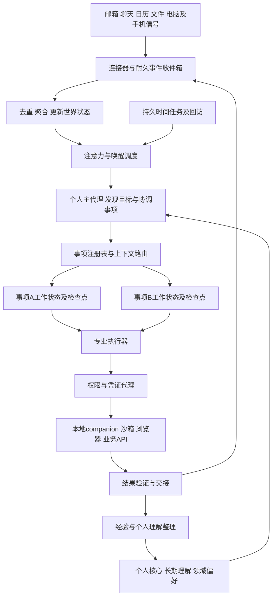

# 个人数字分身架构修订

日期：2026-11-02。状态：社区源码与官方文档支持的设计草案，尚未按本架构部署。当前应用只能证明一个真实模型工具闭环；它缺少持续外部观察、事项级上下文、跨设备执行与可核验交接，不能称为完整数字分身。本轮保留现有程序作实验件，不以已经写好的代码或当前Node版本限制底座选择。

## 1 产品契约

用户给出长期使命、可观察范围、行动权限与资源预算。代理负责持续了解用户、发现值得承担的事务、自主选择和推进目标，从结果与纠正中适配。邮箱、日历、代码或饮食只是能力和观察来源，不是必须执行的固定业务路线。

系统必须同时解决：信息怎样持续进来、何时值得思考、事项怎样隔离并交叉、目标怎样变成真实工作、结果怎样交接和验证、反馈怎样改变以后行为。自主性体现在目标与策略选择；可靠性由持久状态、连接器和工具边界支撑。

## 2 总体分工

这些是逻辑边界，不要求搭建十个微服务。优先采用一个完整代理底座的现成能力，外接缺失的采集器和专业执行器；唯一的任务所有权、权限来源和持久调度必须明确，不能由多套框架同时管理同一事项。

## 3 什么会唤醒它

采集、入库、模型推理、通知用户是四个独立动作。连接器低成本持续监听/同步，大量观察只存储或聚合，不直接调用大模型。

| 唤醒类别 | 具体事件 | 调度行为 |
| --- | --- | --- |
| 外部变化 | 新邮件/同线程回复、会议改期、允许频道新消息、指定文档改变 | 根据来源身份、事项关联和信息增量合并或立即处理 |
| 用户交互 | 主动聊天、纠正、接管、撤销某项授权 | 优先进入相关事项；必要时中断该事项的旧计划，而非清空所有工作 |
| 任务内部 | 测试结束、下载完成、执行器失败、审批结果、设备重新联机 | 唤醒相应事项，带结果与检查点恢复，不重做整个任务 |
| 自主时间点 | 模型决定稍后核查、截止前准备、等待回复超时、试验回访 | 每个事项独立持久计划，并可取消/改期；机器断电后按时效决定补做或放弃 |
| 机会性检查 | 用户回到电脑、出现足够工作空档、近期观察达到聚合阈值 | 判断是否值得利用新机会；AFK/前台窗口只提供线索，不等于准确意图 |
| 维护与学习 | 订阅将过期、同步断档、需要整理经验、上次操作结果不明 | 同步和维护尽量无需LLM；学习不必通知用户；结果不明先查账 |

注意力路由先用确定性规则和来源线程映射处理重复/显然无关事件，再让模型处理需要理解的部分。选择包括立即思考、合并到某个时间、只更新状态、忽略。模型仍可以自行发现新目标和设置回访；调度层不规定它必须每天做哪些生活事项。

**独立思考与定时机制兼容。** 无新消息时，模型可复查未完目标、核查重要未知、主动收集证据或判断是否值得了解用户。它的“该做什么”来自个人使命和观察；定时器仅提供执行机会。没有价值增量时应减少检查频率，不能为了在线而反复制造建议。

接入实现优先复用Nango checkpoint/records流、现有聊天运行时和专门邮箱SDK。Gmail/Graph的通知只是变化线索，必须回拉并提交增量游标；事件重复、漏报和断线要能补账。细节与来源见[接入研究](ingestion-research.md)。OpenClaw当前已把heartbeat迁为普通Automations，选择该底座时复用其持久任务，而不是另造一套heartbeat后台循环。[官方迁移说明](https://docs.openclaw.ai/gateway/heartbeat)

## 4 资料从哪里来

第一阶段应接一个持续信息流，例如邮箱，配合与代理的直接聊天。随后按可用接口扩展授权文件、日历、ActivityWatch电脑上下文、微信bot或允许渠道、手机companion。手动上传是补充，不是长期主要感知方式。

| 来源 | 实际可见内容 | 不能据此假定 |
| --- | --- | --- |
| 邮箱 | 授权账户的邮件、线程和允许的附件 | 第三方邮件中的要求自动具有用户授权；未读状态等同全部新邮件 |
| 微信/IM渠道 | 接口实际投递给bot或允许频道的消息 | 接上bot便能读取所有好友私聊和历史 |
| 电脑上下文 | 授权目录变化、窗口/应用/AFK、可选浏览器tab信息 | 系统日志包含完整用户行为；窗口前台表示用户一直专注 |
| 可选屏幕/音频 | 允许app/时间/区域内的OCR、转写、可见内容 | 截图是完整真实行为；默认应捕获所有屏幕与麦克风 |
| Android/iPhone | 操作系统准许的通知、使用时段、用户设置的自动化信号 | 存在通用接口可随意读取其他app私有数据库或全部操作历史 |

数据记录应区分本人、其他人、代理与系统。跨设备保留发生时间、接收时间和时区。代理自己写文件、发通知产生的事件带causation标识，不能重新当作用户行为学习，也不能触发无限“自己响应自己”。

低侵入感知优先评估[ActivityWatch](https://github.com/ActivityWatch/activitywatch)及其[浏览器watcher](https://github.com/ActivityWatch/aw-watcher-web)；更深内容可参考[Screenpipe](https://github.com/screenpipe/screenpipe)，但其当前是自定义商业许可证，不能沿用旧MIT印象。[感知与用户建模研究](perception-and-user-model.md)给出接口、许可证和可见性边界。

## 5 事项是短期记忆与工作的主单位

“短期”描述用途和作用域，不意味着只放内存；一个持续一周的UI事项，其工作状态应可靠保存一周甚至更久。

| 实体 | 生命周期与职责 |
| --- | --- |
| Person / AgentIdentity | 用户的长期理解与代理自身职责分别建模，不混成一个人格提示词 |
| Case / Matter | 一件持续事务；含目标、状态、工作记忆、权限、预算、成果与回访条件 |
| Thread | 某段交谈或某个来源线程；多个渠道thread可归入同一事项，一条对话也可涉及多事项 |
| Task | 事项内可分派的动作，如检查项目、修改组件、准备方案或核对日程 |
| Run / Attempt | 某次模型/worker运行及费用、错误；它不等于事项，也不等于执行步骤检查点 |
| Checkpoint / Receipt | 足以恢复的状态及真实外部动作结果；避免重启后重复付款、发信或覆盖文件 |

新事件先根据provider thread/object、项目、联系人和任务引用路由；无法唯一归属时保留候选关联并小范围判断。不能只凭相似关键词把两件事合并。合并、拆分与改归属留审计记录。

每个事项有自己的工作上下文。UI事项装载repo、组件、规范、改动、测试、待决方案；午餐事项装载今天的时间、饮食约束、候选、准备状态。主代理只接收各事项必要摘要和需要协调的资源，不反复塞入全部原始历史。

## 6 长期记忆与跨事项共享

建议分五层：

1. **个人核心和阶段目标**：本人明确的原则、授权边界、重要承诺，以及有证据但可纠正的价值/交互偏好。代理不能自行把“帮助我”改成效率或健康最大化。
2. **长期语义事实**：相对稳定或有有效期的事实、偏好、联系人、项目关系。
3. **情节证据**：原消息、邮件变化、行动、反馈与实际结果，保留主体和时间。
4. **程序经验与技能**：在何种条件下采用什么方法、为何有效、怎样验证、已知失败条件。
5. **事项工作记忆**：当前状态、短期推断、计划、检查点、未完成工具动作，默认限定case。

一次worker调用的上下文为“当前事项工作状态 + 少量相关个人核心 + 当前新增事件 + 按scope检索的长期事实 + 允许工具与验收条件”。检索必须在程序/存储层按case、领域、数据权限过滤，不能仅靠提示词提醒模型别串事。

跨事项共享用被明确挑选的事实或引用：午餐事项可以读取“12:00–14:00有会议”的availability，不需要UI项目源码。UI工作发现“用户今天中午需专注上线”，可以提交时间占用事实给协调层，由协调层影响午餐安排。

**共享晋升不能等同于摘要。** “这次UI不做工作台”先保留为该项目的设计反馈；得到跨事件证据或明确普遍表达后，才形成“偏好简洁界面”的领域结论。未必能推广成“所有沟通都越短越好”。临时推断可在窄范围参与行动，无需每条人工确认，但不能自行变成全局权威。

记忆保存source/evidence、scope、subject、assertion级别、valid时间、learned时间与supersedes。冲突新增版本或标记争议，不能覆盖后忘掉原依据；删除同步到检索索引与派生摘要，阻止从旧检查点复活。经验整理异步批量进行，其结果仍要遵守这些范围和权威。

可直接复用的机制：Mastra当前推荐thread OM并按需跨thread recall，已弃用把所有线程观察混合的resource OM；LangGraph用thread checkpointer保存短期状态，用namespace Store保存跨线程数据。两者是替代路线，不能为同一状态引入两个主运行时。[Mastra OM](https://mastra.ai/docs/memory/observational-memory)、[LangGraph持久化](https://docs.langchain.com/oss/javascript/langgraph/persistence)

个人动态理解可对照Honcho的Peer/Session/范围检索；关系与时态复杂后再评估Graphiti。图谱、向量检索与个人代理是不同部件，不能因为装了记忆库就宣称形成了人格。候选及当前代码缺口见[记忆研究](memory-research.md)。

事项隔离、检索范围与安全授权需要分别验证。Honcho的peer仍有统一表征，scope成员和派生结论更新存在异步收敛；Graphiti的group分区也不是ACL。敏感事项不能仅凭一个scope参数宣称已强隔离。共享个人核心由一个受控、带版本的写入路径合并，各事项提交候选更新，避免多个worker互相覆盖或各自形成矛盾的全局人格。

## 7 自主决策策略与验收

观察到“UI代码在改动”并不自动推出“用户需要UI建议”。个人主代理先形成可反驳的需求假设，结合显式目标、相关事件、本人取舍、时效、预期帮助、代价、重复程度和不确定性选择：继续观察、了解、后台准备、行动、通知或不做。分数若使用，应当是待校准的排序辅助，不能把模型自报的0.99当可靠概率。

每个选择记录简短依据和可验证预期。一个未知偏好既可通过合适时机询问，也可通过低代价尝试了解；“用户沉默”不自动计为正负反馈。自身输出不能作为新用户事实，第三方输入也不能扩大权限。

所有事项不必共用一个串行worker。可以多个专业worker并行，但同一事项状态、同一文件、同一浏览器、同一订单等资源需要明确所有权或锁。用户新指令可以中断相关事项；后台工作在预算与可见性范围内继续，不能让某个长任务阻塞所有交互。

学习包含两条不同循环：用户模型修正“对这个人理解得是否准确”，程序经验修正“这种工作怎样做好”。任一轮成功不代表人格收敛；评价要观察不同情境下是否减少同类误解和管理负担。

个人理解与执行能力并行成长，不需要等待一个“人格已完成”的时刻才开始工作。冷启动依靠通用能力和明确范围完成小任务，真实接管、修改和使用结果反过来更新理解；没有真实行动结果，只研究人格描述也无法检验是否像本人。

## 8 本地权限与真实执行

人格影响怎样判断和工作，不授予操作能力。需要本地文件、IDE或程序时，由配对companion在本机执行。常驻服务不必拥有整个Windows账户权限。

- 开发任务可一次授权某个项目根目录及允许动作，让worker连续编辑、安装必要依赖、运行检查、启动预览；任务空间采用worktree，真正隔离由容器/VM/OS权限提供。
- 日历、邮箱、通知优先使用真实业务API，浏览器用于无API的交互；每个服务凭证由独立broker保管，并限制操作范围。
- 用户接管同一浏览器或工作空间时，代理暂停争用资源，恢复前重新读取实际状态。
- 机器离线时，服务端仍能做邮箱/资料工作，本地任务等待联机；不能把等待标为完成。授权撤回后拒绝新动作，保留已在途请求的真实状态。
- 付款、发信、发布等外部副作用有匹配对象/内容/金额/时效的授权与回执；超时后先查真实状态再重试，持久框架不能自动提供所有外部API的exactly-once保证。

优先复用OpenClaw node host、受控exec、managed worktrees和secret机制；专业代码工作对照OpenHands SDK/Agent Server，浏览器对照Stagehand与Playwright。审批、worktree、MCP或浏览器context都不能单独当成操作系统沙盒。[执行与交接研究](execution-research.md)

## 9 成果怎样交接

统一对话入口只呈现“做了什么、证据/成果在哪里、需不需要你处理、下一步怎样继续”，不要求用户经营工作台。

| 工作类型 | 交接对象 | 完成的依据 |
| --- | --- | --- |
| UI优化 | 实际repo/worktree、diff/commit、有效预览地址、测试/截图、未解决项 | 当前改动对应的检查与真实交互；建议稿不是代码交付，build成功不是全部功能验证 |
| 日历安排 | 真实日历资源链接、event ID、回读时间/时区 | 写入成功且回读一致；草稿JSON不算创建 |
| 提醒 | 已登记调度与通知回执 | queued/accepted/delivered/read分开；不支持已读的渠道不编造已读 |
| 购物准备 | 真实清单/购物车、库存、总价、待定条件 | prepared不等于paid；下单要订单ID与状态 |
| 研究和材料 | 可编辑文件、来源、关键结论、适用范围 | 符合事项验收要求；仅存在一个Markdown不能证明需求已解决 |

事项状态至少区分exploring、working、prepared、awaiting_input、verified、delivered、uncertain、failed、cancelled。技术动作成功、用户接受与实际收益分别记录。预览失效、环境回收和用户接手都需要可恢复引用或明确保留期。

## 10 同时发生的两件事

以下是拟议架构示例，不是已完成的实测：

1. 邮箱同步发现“明天需演示UI”的新消息，关联项目A；本地项目文件又有改动，合并进入UI事项。
2. 主代理结合项目目标与已有设计偏好，自主判断“先检查当前版本能否演示”有价值，派代码worker到授权工作树运行、验证、修复。
3. 同时日历数据表明中午连续开会，临近的自主回访触发午餐事项。该事项只读取饮食偏好、时间和准备条件，不加载UI的组件、日志或对话。
4. 两事项共享的是时间占用和用户当前可被打扰程度。UI测试完成事件继续唤醒UI worker；午餐准备可以独立完成，不能被长时间构建阻塞。
5. UI交接真实预览和diff；午餐交接可用安排或清单。用户一句“这个太复杂”由对话上下文归到正确事项，无法确定时问一个短问题，不能同时改写所有偏好。
6. 长期经验只保留有适用范围的结论；今天的菜单和临时构建输出留在事项，事项结束后归档/按策略清理，不都进入全局人格。

## 11 底座选型与下一步

先比较三条互斥主路线，不立即叠加全部项目：

| 路线 | 优势与需要补的部分 |
| --- | --- |
| OpenClaw为常驻底座 | 优先验证。渠道、持久Automations、节点、权限与secret已有；补个人事项策略和有范围的记忆层，专业工作以worker接入 |
| Hermes为个人学习底座 | 对照。个人memory、技能学习、cron、gateway和多个执行后端已有；验证scope、provider插件、实际权限与后台接管 |
| Mastra或LangGraph为应用运行时 | 对照。更清晰地建立事项thread、工作状态与跨线程store；须额外组合常驻渠道、companion与权限服务，自定义工作较多 |

Pi和OpenHands可以作为专业执行器，不必同时成为另一个主调度者。Honcho/Graphiti等按实际缺口选择一个小范围试验，先不引入多套互相写记忆的系统。Nango、现有n8n等选一个主要同步途径，避免每个账户重复同步和不同游标互相打架。

下一阶段验收重点从“能调模型”改为三个场景：

1. **连续观察可靠性**：一个真实持续来源经授权接入，重复/乱序/丢通知/过期游标/断线后能补账，任务不会因此重复外部操作。
2. **多事项隔离与共享**：UI与午餐两事项并行，私有工作上下文不串入；指定共享事实可被正确检索；纠正仅影响适用事项/领域。
3. **真实工作交接**：在授权repo完成小改动并交付可继续接手的结果；日历或通知等至少一种业务动作有真实回读或回执，中断和设备离线状态可信。

补充运行要求：每个来源的故障、游标和重试分别记录，单个邮箱或插件故障不阻塞全部事项；账号令牌失效、权限撤销、数据删除和执行器离线可定位到具体影响范围。原始事件、截图/转写、摘要、向量和成果分别有保留与备份策略。升级采用锁定版本、数据迁移与合同测试，先验证恢复与回滚，不直接追随HEAD自动替换私人代理。

这些试验决定底座，不能因为当前原型已有一些代码而继续叠功能。本轮未调用个人付费模型、安装采集器、接入邮箱或授予本地工作权限。
